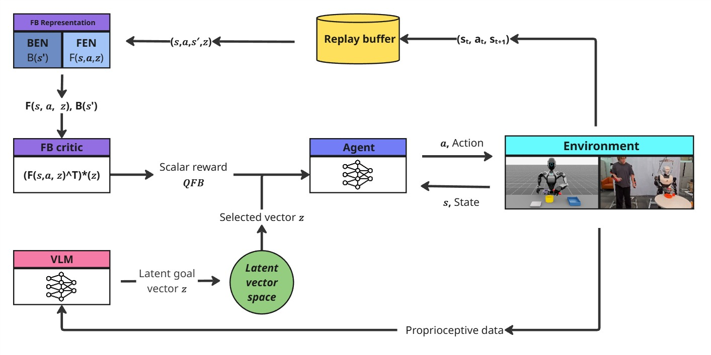

# 🧠 Behavior Foundation Model for humonoid robots

This project presents a development framework for training a Behavior Foundation Model (BFM), including core modules, training pipeline, and a vision-language-conditioned goal interface. It also includes sample model definitions for agent behavior and latent representation learning.

# 📝 Updates
> V2 27 Apr. 2026
 - Offline trainir, Immitation learning like

# 🎓  Tutorial for training
To train model on your own data use this [tutoral](tutorial.md)

## Vanilla Forward-Backward BFM

The measured-state, reward-free Vanilla FB pipeline is documented in
[docs/vanilla_fb.md](docs/vanilla_fb.md), including Zarr v2 collection, training,
goal/reward inference and Isaac evaluation commands. It uses 28D measured
states and 8D right-arm actions, independently of the legacy BC pipeline.
See [validation results and remaining simulator prerequisites](docs/vanilla_fb_results.md).

# 📊 Dataset used in project

https://huggingface.co/datasets/b4r4d41z/Bimanual-humanid-tasks
